# VoteSecure AI — Secure online voting with AI integrity monitoring

> **Showcase repository.** The source code is private; screenshots, architecture and security design are below. Code walkthroughs available on request.

**Live demo:** https://muazzam-votesecure.vercel.app — voter `ali@demo.votesecure`, commission `admin@demo.votesecure`, observer `observer@demo.votesecure`, password `Demo@12345` (OTP codes for demo accounts appear in the in-app demo inbox) · **Author:** Muazzam Khan, AI Developer

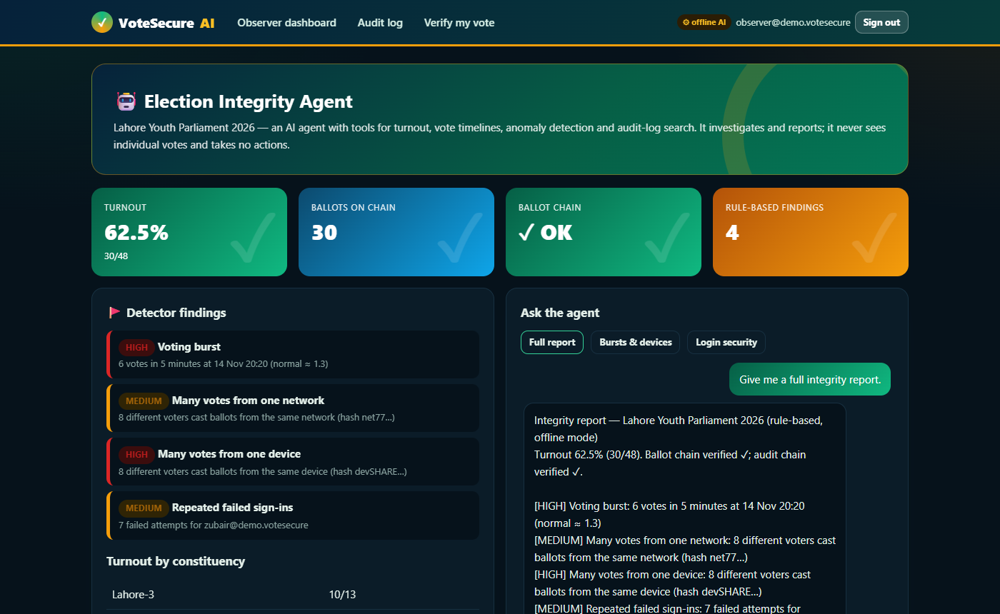

## Highlights

| | |
|---|---|
| 🔐 **2FA sign-in** | Password + self-hosted CAPTCHA + 6-digit email OTP (hashed, expiring, attempt-limited); lockout per account and network |
| 🕶 **Secret ballot** | "Who voted" and "what was voted" stored separately; ballots Fernet-encrypted with no link to the voter |
| ⛓ **Verifiable** | SHA-256 hash-chained ballots on a public bulletin board; receipt codes let voters prove inclusion without revealing choices |
| 🔓 **Safe tally** | Chain re-verified before decryption; any altered/inserted/removed ballot aborts the count |
| 📜 **Tamper-evident audit** | Hash-chained audit log; IPs/devices stored only as keyed hashes |
| 🤖 **Election Integrity Agent** | LangChain tool-calling agent (Claude): turnout, vote timeline, anomaly scan (bursts, shared devices/networks, credential stuffing, chain/count checks), audit search → severity-ranked report |
| ⚖️ **Neutral Ballot Assistant** | Answers from manifestos only, equal space per candidate, refuses to recommend; neutral AI comparisons and results summaries |

| Landing | 2FA | Voter dashboard |
|---|---|---|
| 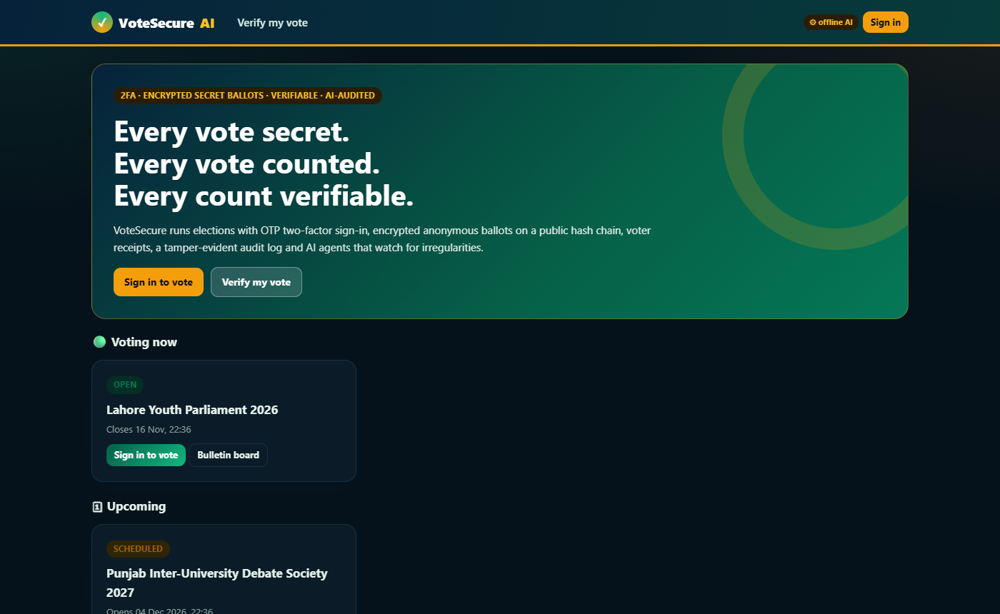 | 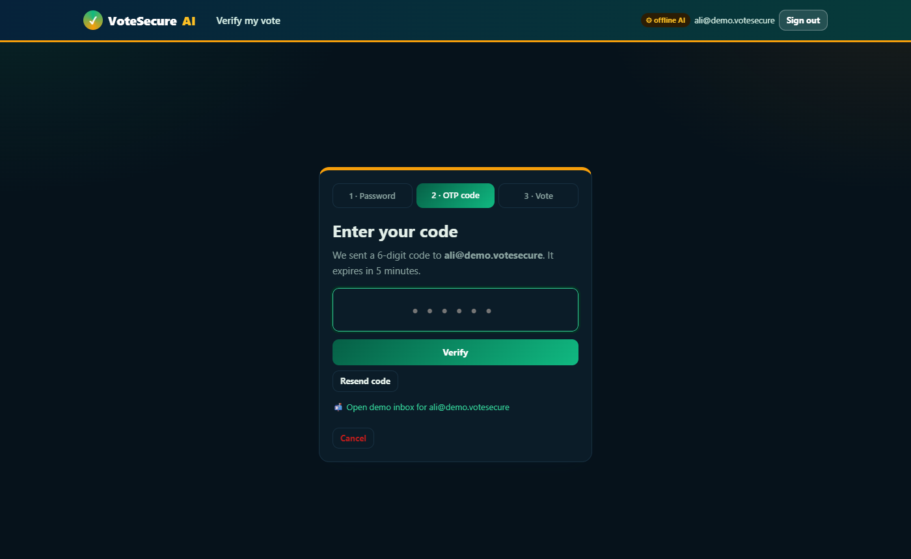 | 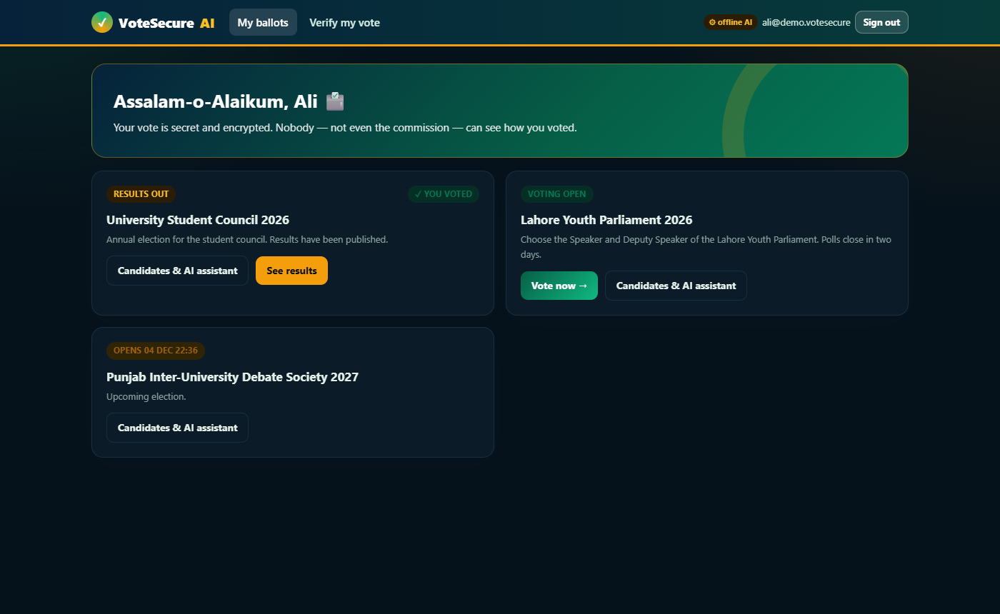 |

| Ballot Assistant | Ballot | Receipt |
|---|---|---|
| 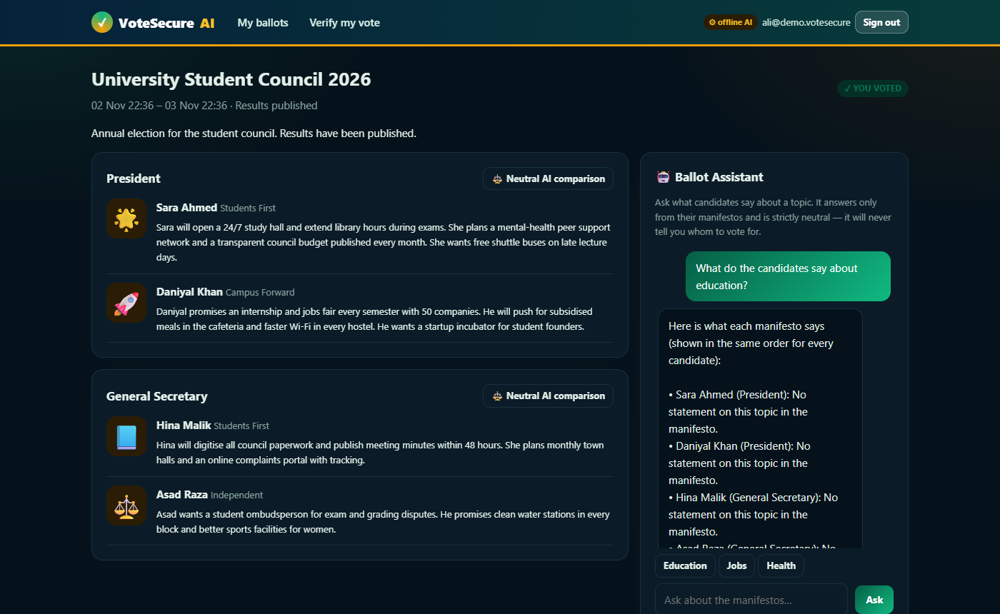 | 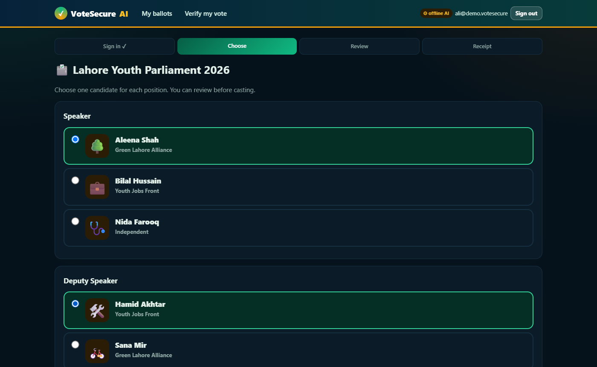 | 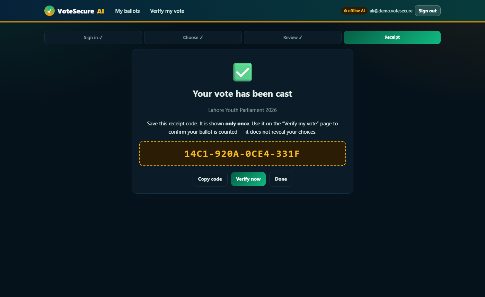 |

| Commission dashboard | Audit log | Results | Bulletin board |
|---|---|---|---|
| 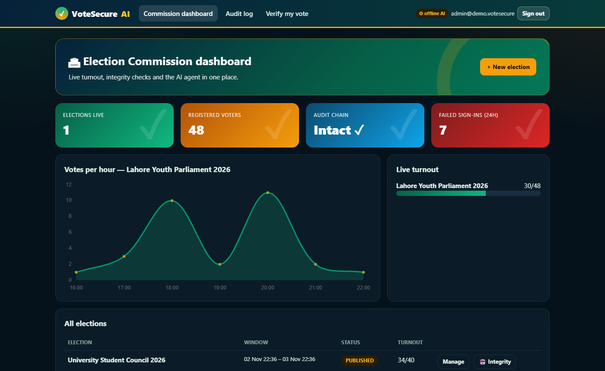 | 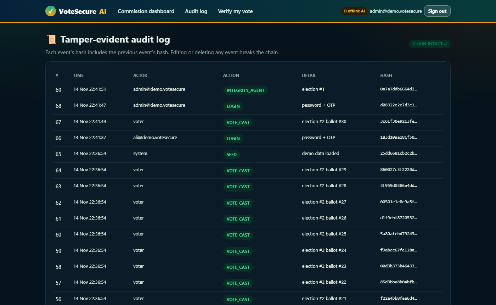 | 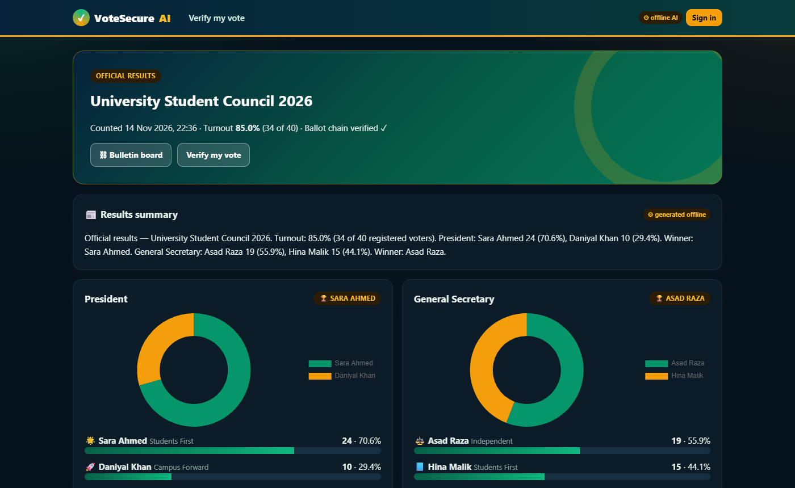 | 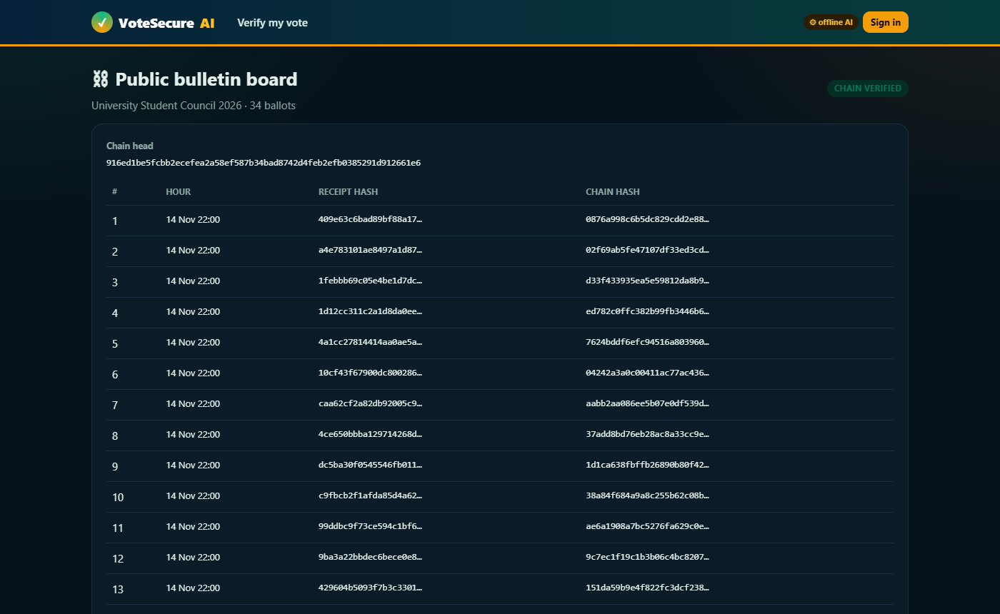 |

## Architecture

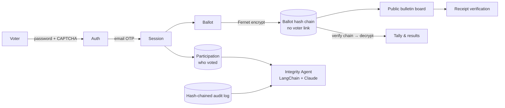

## Tech stack

Python · Django 5 · PostgreSQL (Neon) · cryptography (Fernet) · SHA-256 hash chains · LangChain · Claude · tool-calling agents · Chart.js · WhiteNoise · Vercel · 16 Django tests
